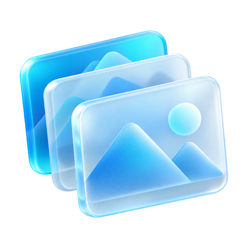
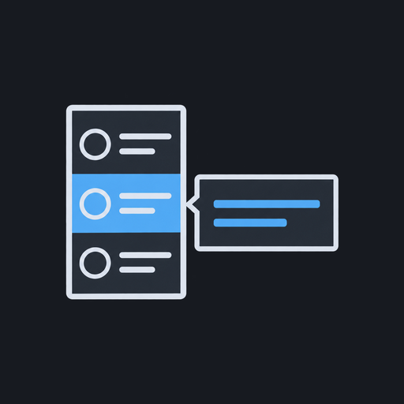
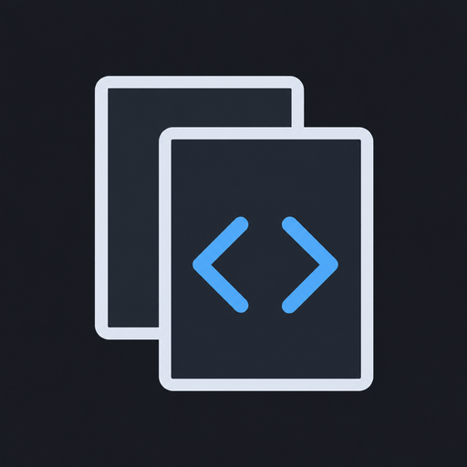

# dsh-plugins · shellRaining 的 DSH 插件集

[DeepSeek Harness (DSH)](https://github.com/deepseek-ai/deepseek-harness) Web GUI 插件合集：Win10 Fluent 主题、批注、侧边对话、Mermaid 图表、会话自动命名等。全部走官方 profile 机制挂载，不改 DSH 源码；按需单独安装。

## 插件索引

| 图标 | 插件 | 功能 | 安装 |
| --- | --- | --- | --- |
|  | [Win10 Fluent 主题](plugins/fluent-theme) | Windows 10 风格的亚克力背景、Reveal 光效和交互动效 | `dsh plugin --profile web add @shellraining/dsh-fluent-theme` |
|  | [批注](plugins/annotation) | 选中文字添加批注，随消息发送原文和批注 | `dsh plugin --profile web add @shellraining/dsh-annotation` |
|  | [侧边对话](plugins/side-chat) | 派生临时对话，不追加到主会话，但可修改工作区文件 | `dsh plugin --profile web add @shellraining/dsh-side-chat` |
|  | [Mermaid 图表](plugins/mermaid) | 切换 Mermaid 代码与图表视图 | `dsh plugin --profile web add @shellraining/dsh-mermaid` |
|  | [Streamdown](plugins/streamdown) | 助手回复流式渲染，引擎 fork 自 lobehub/streamdown | `dsh plugin --profile web add @shellraining/dsh-streamdown` |
|  | [会话自动命名](plugins/session-auto-rename) | 根据对话自动命名，支持自定义标题格式和摘要语言 | `dsh plugin --profile web add @shellraining/dsh-session-auto-rename` |
|  | [会话悬浮预览](plugins/sidebar-session-preview) | 悬停侧栏会话，预览最近消息 | `dsh plugin --profile web add @shellraining/dsh-sidebar-session-preview` |
|  | [行内代码复制](plugins/inline-code-copy) | 点击助手回复中的行内代码即可复制 | `dsh plugin --profile web add @shellraining/dsh-inline-code-copy` |
|  | [插件更新](plugins/plugin-updates) | 检查 npm 插件新版本，更新或安装指定版本 | `dsh plugin --profile web add @shellraining/dsh-plugin-updates` |
|  | [shellRaining 品牌](plugins/shellraining-brand) | 替换侧栏和首页的品牌标识；fork 后可替换为自己的资源 | `dsh plugin --profile web add @shellraining/dsh-brand` |

## 包名迁移

以下三个插件以新 npm 包名发布，旧包不会自动升级为新包：

| 旧包 | 新包 |
| --- | --- |
| `@shellraining/dsh-acrylic-wallpaper` | `@shellraining/dsh-fluent-theme` |
| `@shellraining/dsh-local-annotation` | `@shellraining/dsh-annotation` |
| `@shellraining/dsh-session-title-layout` | `@shellraining/dsh-session-auto-rename` |

迁移前备份 profile 配置，移除旧包后再安装新包，不要同时启用新旧实现。不要清除浏览器站点数据；在相同来源下，壁纸、批注和显示偏好继续使用原来的本地存储。

Cordis 配置 ID `acrylic-wallpaper`、`local-annotation`、`session-title-layout` 保持不变，按 ID 编写的配置覆盖可以保留。显式引用旧 npm 包名或源码目录的配置需要改为新名称；主题和自动命名的源码目录分别改为 `plugins/fluent-theme`、`plugins/session-auto-rename`。迁移失败时移除新包并恢复旧包与备份配置，不清理本地存储。

列表显示名称由包内 `locale/zh.json` 和 `locale/en.json` 的 `meta` 提供，与安装用的 npm 包名分开维护。Streamdown 保留项目名，上游来源和许可见各插件说明。

## 兼容性

插件按 DSH `0.2.1-rc.x`（`@deepseek-ai/dsh-client-ui-* 0.2.1-rc.3`）开发与验证；DSH 的 client 注入 API 仍在 rc 阶段，升级 DSH 后如插件报 token 缺失，等待本仓库适配即可。

## 开发

开发环境使用 Node 24.9+、pnpm 12.6.0（由根 `packageManager` 固定）。插件运行时要求仍以各包的 `engines` 为准：

```sh
pnpm install
pnpm typecheck # 全部插件类型检查
pnpm build     # 全部插件构建（typecheck + Vite；有 types 导出的包另生成声明）
```

构建使用 Vite 8 / Rolldown，类型检查使用 TypeScript 7 原生编译器 `tsc`（原 tsgo 项目的正式版本）。共享构建适配在 `tools/build-plugin.ts`，各包用 `build.ts` 声明入口、产物与 external；客户端继续按 DSH ModuleLoader 契约输出，不启动独立 Vite 页面。

所有直接依赖版本集中在 `pnpm-workspace.yaml` 的 `catalog` / `catalogs` 中，各包 `package.json` 保留依赖名并引用 `catalog:`；peer 兼容范围使用独立的 `peers` catalog。仓库只保留根锁文件。新增或升级依赖先修改 catalog，再运行 `pnpm install`。`pnpm pack` / `pnpm publish` 会把 catalog 引用转换成普通版本，不影响插件独立安装。

发布由 GitHub Actions 完成：修改插件的版本号并推送到 main，流水线会把 npm 上还没有的版本发布出去，细节见 [docs/quality.md](docs/quality.md)。

所有插件业务源码使用 strict TypeScript，生成的 JavaScript 不手工维护。开发入口与约束见 [AGENTS.md](AGENTS.md)，架构见 [docs/ARCHITECTURE.md](docs/ARCHITECTURE.md)，插件规范见 [docs/plugins.md](docs/plugins.md)，验证与测试权限见 [docs/quality.md](docs/quality.md)。agent 不得自行新增或改写测试。

## 许可

MIT。`plugins/mermaid` 基于 [MrmoLabs/dsh-mermaid](https://github.com/MrmoLabs/dsh-mermaid)（MIT，Mrmo072），沿用其许可并保留署名。`plugins/streamdown` 的流式引擎基于 [lobehub/streamdown](https://github.com/lobehub/streamdown)（MIT，LobeHub），部分组件移植自 [deepseek-harness](https://github.com/deepseek-ai/deepseek-harness)（MIT，DeepSeek），署名见该包的 LICENSE。
