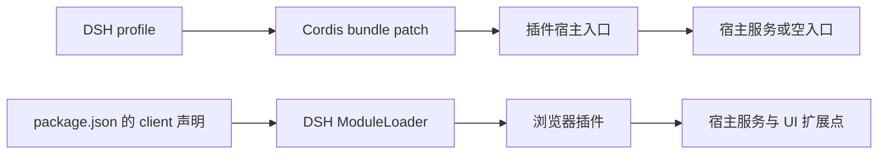

# 架构

本仓库是 pnpm monorepo，`plugins/*` 中每个目录都是独立的 DSH 插件包。根 package 只编排构建、类型检查和仓库级验证，不提供插件运行时。

## 接入方式

插件通过 `dsh plugin --profile web add <包名>` 安装，`package.json` 的 `dsh.bundle.patch` 指向 Cordis overlay。需要浏览器行为的插件声明 `dsh.client` 和 `./client` 导出，客户端产物通过 `window.__ModuleLoader__.load` 注册。纯宿主插件可以不提供客户端。

安装与加载契约以各包的 `package.json`、`cordis.patch.yml` 和构建脚本为准。不要仅凭文件名判断入口，现有包同时存在根目录和 `lib/` 两种产物布局。

## 模块边界

- `plugins/*/src/`：TypeScript / TSX 实现与局部类型契约。
- `plugins/*/build.ts`、`tsconfig*.json`：单包入口、external 和严格类型检查配置。TypeScript 7 原生 `tsc` 负责检查，Vite 8 / Rolldown 负责 JavaScript 构建；对外提供 types 的包另用 `tsc --emitDeclarationOnly` 生成声明。
- `tools/build-plugin.ts`：共享的 DSH 构建适配。客户端输出单文件 CJS 并封装 ModuleLoader；已自行注册 ModuleLoader 的源码输出无导出的 IIFE，宿主输出 ESM；关闭输出目录清空和 public 复制，原子替换产物。
- `pnpm-workspace.yaml`：workspace 成员及全部直接依赖版本的 catalog。各包保留依赖声明和独立发布边界，根锁文件记录整个工作区。
- `plugins/*/README.md`：插件用途、安装与开发说明。
- `tools/tsconfig.json`：检查共享工具和各包 `build.ts`，Node 原生执行可擦除类型的 TypeScript 构建脚本；仓库不保留测试套件。
- `docs/`：跨插件的架构、开发和验证规则，不复制各包的实现细节。

插件之间不直接引用内部源码，也不依赖另一个插件已经安装。出现重复实现时，先判断是否值得提取公共包；没有稳定的多个调用方，不提前增加共享层。

## 宿主与浏览器

宿主入口负责服务注册或保留空实现，浏览器入口负责 UI 扩展与交互。带宿主服务的插件应像 side-chat 一样区分宿主、客户端和共享协议，避免在浏览器 bundle 中引入 Node.js API。

React 及相关运行时由 DSH 提供。需要这些模块时保持 external，通过 ModuleLoader factory 的 require 获取；不能为绕过宿主依赖声明而打包另一份 React。

DSH client API 仍处于 rc 阶段。适配升级时先核对真实服务、类型和 token，不假设私有 DOM 结构或构建后的类名稳定。具体约束见 [插件开发规范](plugins.md)。
